<div align="center">


<a href="https://github.com/Shakhzodmir">
  
</a>


</div>

<!-- АНИМЕ-КАРТИНКА: вставьте сюда свою гифку или арт (перетащите файл в редактор GitHub — он сам даст ссылку).
<div align="center"></div>
-->

## ⚔️ Player card

```yaml
name:       Shakhzod Miraliev (이로운)
class:      UI/UX Designer × Developer
guild:      AI G-Payments · 개발팀 · 대리 (Assistant Manager)
base:       South Korea
origin:     Uzbekistan
education:  Inha University Graduate School — Convergence Design
languages:  Uzbek (native) · Russian (native) · English (business) · Korean (TOPIK 4)
motto:      一歩ずつ — one step at a time
```

## 🏢 Day job — AI G-Payments

**대리 · 개발팀** at [AI G-Payments](https://www.ai-gpayments.com/main/) — the company behind **지페**, a QR ordering and payment platform for restaurants and stores: guests scan a table QR, order and pay from the phone; owners run orders, menu, sales and a PC POS from one place.

## 🌸 Quests

### Odim — rehabilitation app
Developer. An app that guides patients through recovery exercises and keeps the doctor, the rehab specialist and the patient in one flow.

- 🎨 Design system and every screen, from Figma to production
- 🩺 Separate workspaces for orthopedists, rehab specialists and patients
- 🌏 Three languages, four scripts (Uzbek Latin and Cyrillic, Russian, English)
- 📱 Web + Android

### Korean with Madie — learn Korean from zero
Creator. [koreanmadie.study](https://koreanmadie.study/) · [Google Play](https://play.google.com/store/apps/details?id=study.koreanmadie.app)

- 📚 8 modules, 99 lessons — from Hangul to TOPIK
- 🤖 AI tutor chat, dictionary and translator
- 🎮 20+ practice games: vocabulary, listening, dictation, handwriting, speaking
- 🔥 XP, levels, streaks and achievements

## 🎨 Design

<div align="center">


</div>

UI/UX for web and mobile · brand identity and logo · motion graphics · [Behance portfolio](https://www.behance.net/gallery/246919799/Portfolio)

## 🛠️ Code

<div align="center">


</div>

## 🐍 Designer

<div align="center">
<picture>
  <source media="(prefers-color-scheme: dark)" srcset="https://raw.githubusercontent.com/Shakhzodmir/Shakhzodmir/main/assets/designer-snake-dark.svg" />
  
</picture>
</div>

## 📊 Stats

<div align="center">


</div>

## 📫 Links

<div align="center">

<a href="https://www.behance.net/gallery/246919799/Portfolio"></a>
<a href="https://koreanmadie.study/"></a>
<a href="https://posetrack.pages.dev"></a>

</div>


